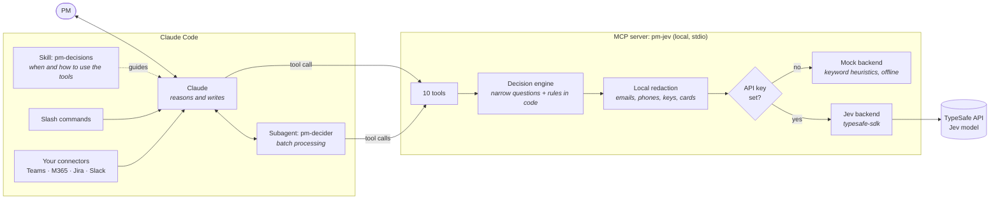
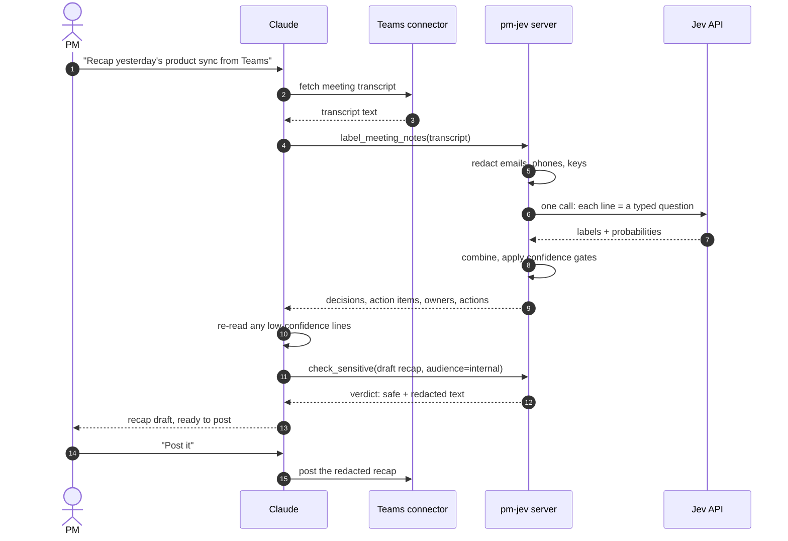
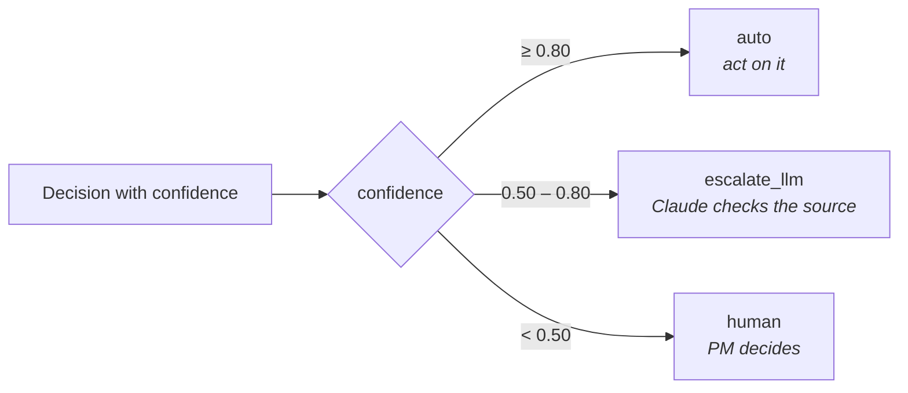
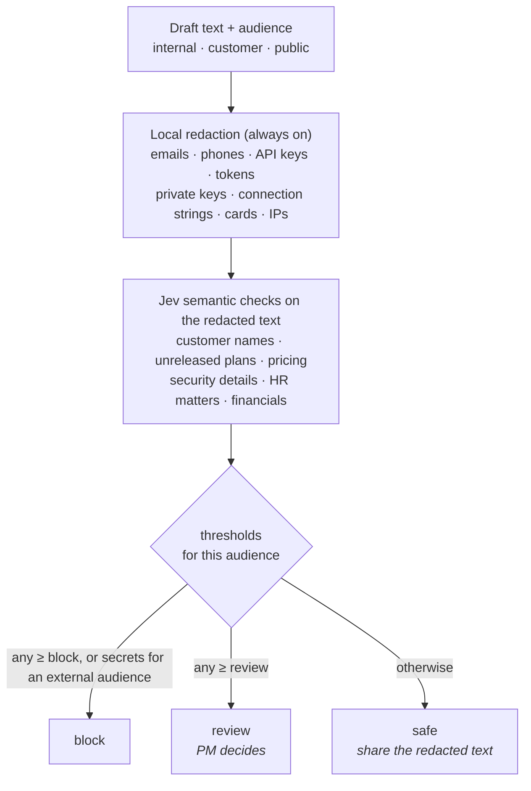

# pm-decisions

**A decision layer for product managers, packaged as a Claude Code plugin.**
Claude writes. [Jev](https://typesafe.ai) decides. You stay in charge of anything uncertain.

Most of a PM's day isn't writing. It's a stream of small, bounded calls:

> *Is this a bug or a feature request? Is it already in the backlog? Is this story
> ready for the sprint? Does this change need a security review? Is that workstream
> actually blocked? Can I post this in the customer channel?*

Every one of those has answers you can list in advance. That makes them a poor fit
for a large language model, which writes an answer word by word that your code then
has to parse. They're a good fit for a **decision model** like TypeSafe's Jev, which
returns typed answers with calibrated confidence in milliseconds, for a fraction of
a cent.

This plugin gives Claude nine of those PM decisions as tools. Claude uses them for
the judgment calls, writes the human-facing text itself, and hands anything
low-confidence back to you.

---

## Contents

- [What it does](#what-it-does)
- [Architecture](#architecture)
  - [System overview](#system-overview)
  - [Anatomy of one decision](#anatomy-of-one-decision)
  - [A request, end to end](#a-request-end-to-end)
  - [Confidence gates](#confidence-gates)
  - [The sharing check](#the-sharing-check)
  - [Design principles](#design-principles)
- [Install](#install)
- [Use it](#use-it)
- [Microsoft Teams, Jira, Slack and other sources](#microsoft-teams-jira-slack-and-other-sources)
- [Configure](#configure)
- [Data handling](#data-handling)
- [Known limits](#known-limits)
- [Extend it: add your own decision](#extend-it-add-your-own-decision)
- [Develop](#develop)
- [Repository layout](#repository-layout)

---

## What it does

| Tool | PM decision | Narrow questions asked in one call |
|---|---|---|
| `triage_feedback` | Route a ticket, review or customer message | category · product area · sentiment · churn risk · urgent |
| `find_duplicates` | Is this already in the backlog? | which item matches, or none (choice over up to 254 items) |
| `check_story_ready` | Definition of ready | user · problem · acceptance criteria · success metric · single scope · clarity |
| `flag_risks` | Who needs to review this change? | billing · security · privacy · compliance · data migration · breaking change |
| `score_priority` | How should this rank? | reach · impact · confidence · effort, combined RICE-style in code |
| `read_status` | What does this standup mean? | on track / at risk / blocked · asked for help · date slip · scope change |
| `label_meeting_notes` | What came out of the meeting? | per line: decision / action item / open question / FYI · has an owner |
| `classify_release_note` | Does this PR go in release notes? | feature / improvement / fix / internal · customer-facing · needs docs · worth announcing |
| `check_sensitive` | Is this safe to share? | customer names · unreleased plans · pricing · security details · HR matters · financials |

Plus `backend_status`, which reports whether you're running against Jev or in offline mock mode.

Around the tools, the plugin ships:

| Piece | What it adds |
|---|---|
| **Skill** `pm-decisions` | Tells Claude when to use each tool, how to respect confidence, how to work through Teams and other connectors, and to check text before sharing it |
| **Subagent** `pm-decider` | Processes large batches (ticket exports, long transcripts) and returns a compact report, so raw output stays out of your main conversation |
| **Commands** | `/pm-decisions:triage` · `:standup` · `:meeting-recap` · `:ready-check` · `:share-check` |

---

## Architecture

### System overview



Three layers, each with one job:

1. **Claude Code** holds the conversation, fetches content through your connectors, reasons about edge cases, and writes everything a person will read.
2. **The MCP server** runs locally on your machine. It turns each PM judgment into narrow typed questions, strips structured secrets, calls the model, and combines the answers with plain, testable rules.
3. **Jev** answers the narrow questions: one parallel pass, typed values, calibrated probabilities. It never writes prose and never sees your raw secrets.

### Anatomy of one decision

The core idea: **don't ask one broad question. Ask several narrow ones, then combine
them in code.** Here is `triage_feedback`:

```mermaid
flowchart LR
    T["Customer message<br/><i>'Refresh failed 3 nights running,<br/>board meeting Friday'</i>"]
    R["Redact locally"]
    T --> R

    subgraph ONE["One Jev call, all questions in parallel"]
        direction TB
        Q1["Choice: category<br/>bug · feature · how-to · praise · complaint · not actionable"]
        Q2["Choice: product area<br/><i>from your config</i>"]
        Q3["Score: sentiment<br/>0 very negative … 4 very positive"]
        Q4["Yes/no: churn risk"]
        Q5["Yes/no: urgent"]
    end

    R --> ONE

    subgraph CODE["Combine in code (engine.py)"]
        direction TB
        C1["route_to = account manager if churn risk,<br/>else the product area"]
        C2["action = least confident of category and area,<br/>raised to escalate_llm if urgent or churn"]
    end

    ONE --> CODE --> OUT["decision + action + raw answers"]
```



Why split it up? In independent testing of decision models, asking one broad question
(*"is this phishing?"*) scored far lower than asking five narrow ones and combining
them. Narrow questions are what these models are good at. And when your priorities
change, you edit a rule or a weight in code, not a prompt you hope still behaves.

### A request, end to end



Claude never posts, sends or shares anything until you've seen the exact text and said yes.

### Confidence gates

Every result carries an `action`, set from the model's calibrated confidence:



The thresholds live in config. Tune them on a few hundred of your own labelled
examples rather than trusting anyone's benchmark. Some decisions are deliberately
stricter: `score_priority` sends any guessed factor back to the PM, and an uncertain
risk flag always goes to a person.

### The sharing check

`check_sensitive` runs before anything leaves your hands:



Pattern matching catches structured secrets reliably but can't understand meaning.
The model catches meaning, such as an unannounced roadmap date, but only ever sees
redacted text. Neither replaces your judgment for external audiences, which is why
`review` always goes to a person.

### Design principles

- **Decide with Jev, write with Claude.** Each does what it's built for.
- **Narrow questions, rules in code.** Weights, thresholds and definitions are editable config, not prompt wording.
- **Confidence is a first-class output.** Nothing silently turns a guess into a decision.
- **Secrets never leave the machine.** Redaction runs locally before every call.
- **No new logins.** The plugin uses the connectors you already have instead of its own Teams or Jira credentials.
- **Works offline for demos.** Mock mode is clearly labelled and never marked confident.

---

## Install

**Requirements:** Claude Code, and Python 3.10+ available as `python3`.

From GitHub:

```
/plugin marketplace add geektuhin123/pm-decisions
/plugin install pm-decisions@pm-decisions
```

From a local clone while developing:

```
claude --plugin-dir ./pm-decisions
```

When the plugin is enabled, Claude Code asks for two settings:

| Setting | Notes |
|---|---|
| **TypeSafe API key** | From [console.typesafe.ai](https://console.typesafe.ai). Stored in your OS secure store, not a settings file. Leave it empty for **mock mode**. |
| **Config file** (optional) | Absolute path to your own YAML config. |

On first start, `scripts/launch.py` creates a private virtual environment in the
plugin's data folder and installs `requirements.txt` into it. Nothing touches your
system Python. Later starts reuse the environment.

**Mock mode.** Without a key, the server answers with keyword heuristics so you can
try the whole workflow. Mock confidence is capped at 0.75, so nothing is ever marked
`auto`, every result says `"backend": "mock"`, and Claude is told to say so. Don't
use mock answers for real triage.

---

## Use it

With slash commands:

```
/pm-decisions:triage examples/feedback.txt
/pm-decisions:ready-check examples/story.md
/pm-decisions:meeting-recap examples/meeting-notes.txt
/pm-decisions:standup examples/standups.txt
/pm-decisions:share-check customer "Acme's renewal is $40 a seat and the planner ships in Q3"
```

Or just ask:

- *"Is this request already in our backlog?"* (with `examples/backlog.json`)
- *"Score these five items for next quarter. Effort for the first one is small."*
- *"Which of these PRs belong in the release notes, and under what heading?"*

From the command line, without Claude:

```
pip install -e .
pm-jev triage --file examples/feedback.txt
pm-jev duplicates "Email me a PDF of the dashboard every Monday" --backlog examples/backlog.json
pm-jev sensitive --audience public --file draft-update.txt
```

Example output, trimmed:

```json
{
  "decision": {
    "duplicate_of": "PROD-101",
    "candidates": [
      {"id": "PROD-101", "probability": 0.70},
      {"id": "PROD-104", "probability": 0.16}
    ],
    "truncated_backlog": false
  },
  "action": "escalate_llm",
  "backend": "jev",
  "redacted": {}
}
```

---

## Microsoft Teams, Jira, Slack and other sources

The plugin has no login of its own for Teams or any other tool. If a Teams /
Microsoft 365, Slack, Jira or similar connector is available in your Claude session,
the skill tells Claude to fetch content through it, then run the decision tools.

- *"Pull yesterday's product sync transcript from Teams and give me the decisions and action items."*
- *"Triage the last 50 messages in the customer-feedback channel."*
- *"Read this week's standup thread and tell me what's blocked."*

Before posting back, Claude runs `check_sensitive`, shows you the exact text, and waits for your yes.

---

## Configure

Copy `config/pm-decisions.example.yaml`, edit it, and set its path in the plugin
settings (or in `PM_JEV_CONFIG`). Anything you leave out keeps the default.

| Key | What it controls |
|---|---|
| `gates` | Confidence needed for `auto` and for `escalate_llm` |
| `product_areas` | Your areas, each with a one-sentence description (Jev reads these) |
| `risk_reviewers` | Who to notify for each risk area |
| `priority_weights` | Exponents for reach, impact, confidence and effort |
| `sensitive_thresholds` | Block and review thresholds per audience |
| `redact_before_send` | Local redaction before every call (on by default) |

Environment variables:

| Variable | Purpose |
|---|---|
| `TYPESAFE_API_KEY` | Jev API key (CLI use; inside Claude Code, use the plugin setting) |
| `PM_JEV_BACKEND` | Force `jev` or `mock` |
| `PM_JEV_MODEL` | Pin a model version such as `jev-1.13.0`. Recommended once you've tuned thresholds |
| `PM_JEV_CONFIG` | Path to your config file |
| `PM_JEV_NO_VENV=1` | Use the current Python instead of the private venv |

---

## Data handling

- Text you pass to a tool is sent to TypeSafe's API. Review TypeSafe's terms, privacy policy and data-retention options before using it with customer data.
- Before every call, local redaction replaces emails, phone numbers, API keys, tokens, private keys, connection strings, card numbers and IP addresses with placeholders such as `[EMAIL]`. `check_sensitive` always redacts, even if you turn redaction off elsewhere.
- Redaction is pattern-based. It won't catch a customer's name or an unannounced date; the semantic checks in `check_sensitive` exist for that.
- The plugin stores nothing and keeps no logs of your text.

## Known limits

- Jev is weak at arithmetic, counting and comparing dates. Keep those in code or in Claude's reasoning.
- Vague questions get unreliable answers. That's why each decision is split into narrow questions.
- If no option fits, Jev still picks one, so choice questions here include a "none" or "other" option where it matters.
- Jev is text-only and works best in English. Test on your own content first.
- Confidence is a signal, not a guarantee.

---

## Extend it: add your own decision

Adding a PM decision takes four small steps.

1. **Write the questions** in `src/pm_jev/engine.py`. Keep each one narrow, and add a "none" option to any choice:

   ```python
   def check_launch_ready(plan: str, backend=None):
       backend = backend or get_backend()
       state, redacted = _prepare(plan)
       questions = {
           "has_rollback": _noul("Describes how to roll back if the launch goes wrong"),
           "has_owner": _noul("Names a single accountable owner for launch day"),
           "support_briefed": _noul("Says support has been briefed or trained"),
       }
       a = backend.ask(state, questions, hints={})
       gaps = [k for k in questions if a[k]["value"] < 0.5]
       action = _worst([gate(a[k]["confidence"]) for k in questions])
       return _result(backend, {"ready": not gaps, "gaps": gaps}, action, a, redacted)
   ```

2. **Expose it** in `src/pm_jev/server.py` with `@mcp.tool()` and a clear one-line docstring. Claude reads that docstring to decide when to call it.
3. **Teach the skill** by adding a row to the tool table in `skills/pm-decisions/SKILL.md`.
4. **Test it**: add a stub-backend test in `tests/test_engine.py`. `tests/test_wire_format.py` will then check your questions against the official SDK automatically, once you add the call there.

---

## Develop

```
pip install -e ".[dev]"
pytest
claude plugin validate .
```

The test suite runs offline. `tests/test_wire_format.py` validates every question the
plugin sends against the official `typesafe-sdk` models, so wire-format mistakes are
caught without an API key.

## Repository layout

```
pm-decisions/
├── .claude-plugin/
│   ├── plugin.json          manifest: metadata and the settings Claude Code prompts for
│   ├── marketplace.json     lets people install straight from this repo
│   └── icon.png
├── .mcp.json                registers the pm-jev MCP server
├── skills/pm-decisions/     SKILL.md: when and how Claude uses the tools
├── agents/pm-decider.md     batch-processing subagent
├── commands/                slash commands
├── scripts/launch.py        creates the private venv, then starts the server
├── src/pm_jev/
│   ├── engine.py            the nine decision sets and confidence gates
│   ├── backends.py          Jev backend (typesafe-sdk) and offline mock
│   ├── redact.py            local redaction
│   ├── server.py            MCP server (mcp SDK 1.x and 2.x)
│   ├── cli.py               pm-jev command line
│   ├── config.py            defaults plus optional user override
│   └── default_config.yaml
├── config/                  example override config
├── examples/                fictional sample data
└── tests/
```

## License

MIT. See [`LICENSE`](LICENSE). Jev and TypeSafe are trademarks of TypeSafe AI. This
project is independent and isn't affiliated with or endorsed by TypeSafe AI.
